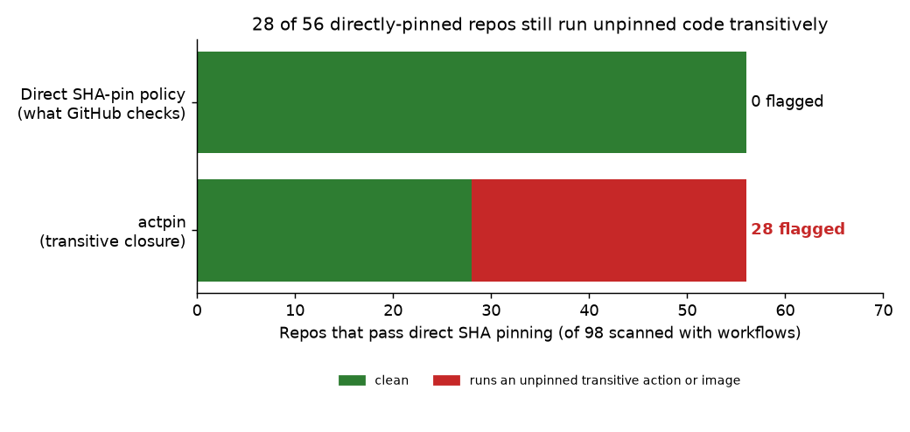
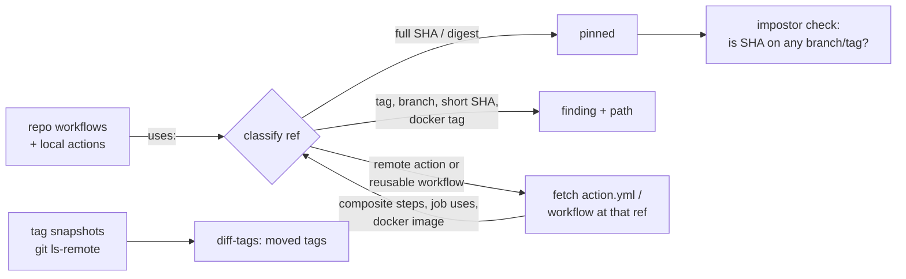

# GitHub Actions Pin Auditor (`actpin`)

A Python CLI for security and DevSecOps teams that follows every GitHub Actions `uses:` reference through composite actions, reusable workflows and Docker actions, and flags each unpinned link, hijacked tag and impostor commit along with the path that reaches it.

## Results

- **Flagged unpinned transitive actions or images in 28 of 56 repos** that pass a direct SHA-pin policy (which flags 0 in them), across a 100-repo public scan.
- **Caught the 2025 tj-actions/reviewdog attack in a recorded replay**: all 360 hijacked tags, both impostor commits, and the depth-2 path into a fully SHA-pinned victim.
- **Matched a brute-force reference resolver on 400 generated action graphs** with cycles, self-loops, missing actions and mixed ref types (Hypothesis property tests).



## Why it matters

In March 2025 attackers re-pointed the `tj-actions/changed-files` tags to a malicious commit, leaking CI secrets from every pipeline that ran it ([CISA, CVE-2025-30066](https://www.cisa.gov/news-events/alerts/2025/03/18/supply-chain-compromise-third-party-github-action-cve-2025-30066)). That attack was itself enabled by `reviewdog/action-setup@v1`, pulled in *transitively* through a composite action. GitHub's [SHA-pinning policy](https://github.blog/changelog/2025-08-15-github-actions-policy-now-supports-blocking-and-sha-pinning-actions/) checks the references a workflow writes directly and says nothing about the ones pulled in through those actions.

**Stack:** Python 3, GitHub Actions YAML (workflows, composite actions, reusable workflows), Git (`ls-remote`, blobless and sparse clones), SARIF 2.1.0, GitHub code scanning, PyYAML, Hypothesis, pytest, matplotlib, HTML/JavaScript

## Quickstart

```bash
pip install -r requirements.txt
python3 -m actpin scan --repos data/repos.txt --limit 100 --out results/
python3 -m actpin replay fixtures/tj-actions-2025 --expect-detected
```

The first command installs dependencies, the second scans 100 public repositories (about a minute, no token) and writes `results/summary.json`, `results/scan.json` and one SARIF file per repo, and the third replays the 2025 incident.

- **Browser report:** [`docs/index.html`](docs/index.html) shows every scanned repo; click a flagged repo to see each transitive chain.
- **Drafted maintainer notes (unsent):** [`docs/notes/`](docs/notes/) has one note per upstream action that pulls in mutable references, with a pin-fix patch where tags can be resolved.
- **SARIF in CI:** [`.github/workflows/actpin.yml`](.github/workflows/actpin.yml) runs the auditor on this repository and uploads the SARIF to GitHub code scanning.

## Commands

| Command | What it does |
|---|---|
| `actpin scan [PATH]` | Resolve a checkout's workflows transitively; print each unpinned link with its path. `--sarif out.sarif`, `--check-impostors`, `--fail-on transitive\|any` |
| `actpin scan --repos FILE --limit N --out DIR` | Scan public repos (sparse blobless clones) and write `summary.json`, `scan.json`, `sarif/` |
| `actpin snapshot --repo o/r --out snap.json` | Record tag → commit maps with `git ls-remote` (`--from-scan results/scan.json` snapshots every action repo seen in a scan) |
| `actpin diff-tags old.json new.json` | List tags whose commit changed between snapshots; exits 1 if any moved |
| `actpin fix [PATH] [--out patch.diff \| --write]` | Rewrite `owner/repo@v4` to `owner/repo@<sha> # v4`, keeping existing comments |
| `actpin replay FIXTURE --expect-detected` | Replay a recorded incident; exits 1 if any expected detection is missed |

Example (from the replay):

```
victim fully-pinned-user: direct SHA-pin policy PASS, 2 exposure(s)
  depth 2: .github/workflows/lint.yml -> tj-actions/eslint-changed-files@74f98653... -> reviewdog/action-setup@v1
  depth 2: .github/workflows/lint.yml -> tj-actions/eslint-changed-files@74f98653... -> tj-actions/changed-files@v45
```

## How it works



1. **Repo files.** `git clone --depth 1 --filter=blob:none --no-checkout` plus a non-cone sparse checkout of `/.github/` and every `action.yml` downloads only the metadata files, not source blobs.
2. **Graph walk.** `actpin/graph.py` parses each YAML file with line numbers and walks the reference graph breadth-first. Each unit (file at a ref) is expanded once, so cycles terminate, and the parent pointers give a shortest path for every finding. Remote `action.yml` and reusable workflows come from `raw.githubusercontent.com` (no token) and are cached on disk.
3. **Direct vs transitive.** References written in the repo's own workflows *and* local composite actions count as *direct*, which is what a direct SHA-pin policy checks. References inside remote units are *transitive*. A repo is counted as exposed only if every direct reference is a full SHA and some transitive link is not.
4. **Impostor commits.** GitHub serves fork commits through the parent repository, so `owner/repo@<sha>` can run code that never landed in `owner/repo`. `ReachabilityChecker` first matches the SHA against `ls-remote` tips, then takes a commits-only (`--filter=tree:0`) bare clone and asks `git for-each-ref --contains`. Lazy fetching is disabled so the promisor remote cannot quietly supply the missing commit.
5. **Tag mutation.** `snapshot` records tag → commit maps (annotated tags peeled), and `diff-tags` reports tags that kept their name but changed commit.
6. **Output.** SARIF 2.1.0 rules `APN001` (unpinned direct), `APN002` (unpinned transitive, with the full chain in the message, anchored on the first hop's line), `APN003` (impostor commit) and `APN004` (moved tag).

## Full results (100-repo scan)

From [`results/summary.json`](results/summary.json). The repo list ([`data/repos.txt`](data/repos.txt)) is weighted toward security-focused and cloud-native projects, which pin actions more often.

| Measure | Value |
|---|---|
| Repos scanned (with workflows) | 100 (98) |
| Pass direct SHA-pin policy | 56 |
| …of which run an unpinned transitive action or image | **28** |
| …via a mutable action/workflow ref | 5 |
| …via a mutable container image tag inside a pinned action | 24 |
| Direct-policy findings in those 28 repos | 0 |
| Repos with any transitive unpinned link (pinned or not) | 61 |
| Direct `uses:` references / unpinned | 12,940 / 1,041 |
| Unpinned transitive links | 213 |
| Remote action and workflow files resolved | 2,605 |
| Deepest chain | 4 hops |
| SHA pins checked for reachability (opt-in run, [`results/impostor_check.json`](results/impostor_check.json)) | 2,022 |
| …not on any upstream branch or tag | 2 (`pnpm/action-setup@c5ba7f78`, `dtolnay/rust-toolchain@29eef336`, both inside third-party reusable workflows) |

Most common transitive links:

| Inside | Mutable reference | Repos |
|---|---|---|
| `ossf/scorecard-action` | `docker://ghcr.io/ossf/scorecard-action:v2.4.4` | 35 |
| `slsa-framework/slsa-github-generator/.github/actions/generate-builder` | `…/secure-builder-checkout@v2.1.0` | 7 |
| `slsa-framework/slsa-github-generator` generic SLSA3 workflow | `…/detect-workflow-js@v2.1.0` and 3 more | 6 |

### tj-actions/reviewdog replay

[`fixtures/tj-actions-2025/`](fixtures/tj-actions-2025/README.md) records the real tag histories, the real `eslint-changed-files` composite action and the real `changed-files` CI workflow. The replay must:

| Check | Result |
|---|---|
| 359 `tj-actions/changed-files` tags and `reviewdog/action-setup@v1` moved | detected (360 moves) |
| `0e58ed86` and `f0d342d2` not on any upstream branch or tag | both flagged as impostor commits |
| Direct `@v45` user exposed | depth 1 |
| Fully SHA-pinned user exposed via pinned `eslint-changed-files` | depth 2, to both compromised tags |
| `tj-actions/changed-files` CI exposed to `reviewdog/action-setup@v1` | depth 2 (the path that leaked the bot token) |

## Tests

```bash
python3 -m pytest -q
python3 scripts/check_summary.py results/summary.json --min-repos 100
```

- `tests/test_properties.py`: Hypothesis generates graphs of composite, reusable-workflow and Docker actions with arbitrary edges (cycles, self-loops, duplicates), ref kinds (SHA, tag, branch, short SHA), missing actions and local composite actions. It renders them to YAML, runs the resolver, and compares distances, the multiset of findings and every reported path against a brute-force enumeration of all simple paths over the *specification*, not the YAML. A pinned example covers a deep path that a depth-first walk would find before the short one.
- `tests/test_git.py`: real git repos on disk: annotated-tag peeling, sparse blobless fetch, tag moves, and an impostor commit that is in the object store but on no ref.
- `tests/test_core.py`: ref classification, YAML line numbers, direct vs transitive, SARIF shape, pin-fix comment preservation, the replay and the CLI.

Regenerate the figure, browser report and notes after a scan with `python3 scripts/plot_results.py && python3 scripts/build_report.py`, and the fixture with `python3 scripts/record_tj_fixture.py`.

## Design notes

- **Policy model.** GitHub's policy works on the references a workflow writes. Here "direct" also includes the repo's own local composite actions, which makes the exposed count conservative: a repo whose local action uses `@v4` is counted as failing, not exposed.
- **Container images count.** A pinned action whose `runs.image` is `docker://…:tag` runs whatever that tag points at today. These links are reported separately (24 of the 28 exposed repos have one) because the fix is a digest, not a commit SHA.
- **`./` inside a remote action** refers to the caller's workspace, not the action repo, so it is recorded as unresolvable rather than guessed.
- **No API token.** Everything uses `git` and `raw.githubusercontent.com`, so the auditor works in locked-down CI and avoids REST rate limits.

## Limitations and next steps

- The scan is a snapshot of each repo's default branch at scan time. Re-running it gives slightly different numbers as projects update, and the repo list is curated rather than a random sample.
- Mutable tags are flagged by pattern; the scan does not check whether a tag has actually moved unless two `snapshot`s are compared. A scheduled snapshot job would turn `diff-tags` into continuous monitoring.
- Impostor checks clone each pinned action's commit graph, so they are opt-in (`--check-impostors`) and not part of the default 100-repo run. An unreachable SHA is not proof of an attack: commits orphaned by a force-push or a deleted branch look the same, and the two found in the scan are most likely that.
- Dockerfile-based actions are treated as content-pinned by the action SHA, but their `FROM` base images are not inspected. Expressions in `uses:` and JavaScript actions that download code at runtime are out of reach of static analysis.
- The replay fixture keeps the attack's tag state and commit IDs but not the malicious code. The pre-attack value of `reviewdog/action-setup@v1` is taken as v1.3.0, the latest v1.x at the time.
- Next steps: resolve tags to SHAs during the walk so findings can say whether a tag has moved since a baseline, inspect Dockerfile base images, and emit a pin-fix patch for every flagged upstream action rather than the top 12.
